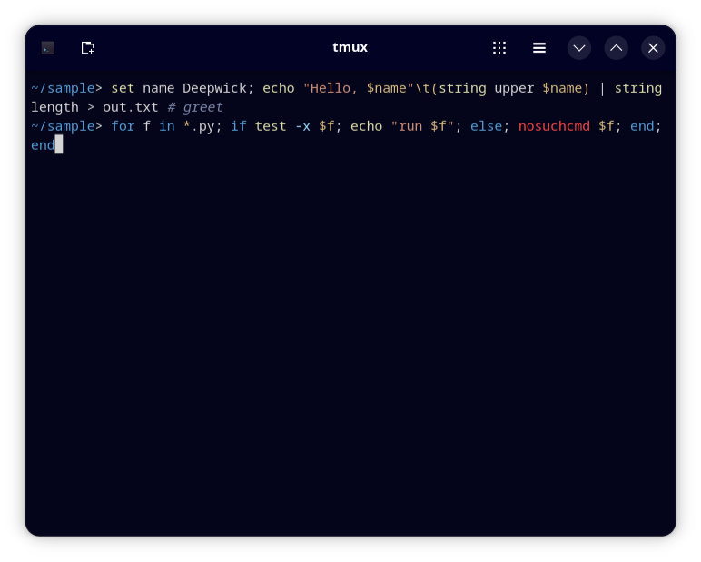

# Deepwick for fish

Deepwick syntax highlighting colors for the [fish shell](https://fishshell.com).

> Deepwick is an unofficial theme derived from
> [Polywick Blue](https://vscode.polywickstudio.net) by Polywick Studio (MIT).
> Not affiliated with Polywick Studio.



## Install

```sh
mkdir -p "${XDG_CONFIG_HOME:-$HOME/.config}/fish/themes"
cp deepwick.theme "${XDG_CONFIG_HOME:-$HOME/.config}/fish/themes/"
```

## Activate

Add to `~/.config/fish/config.fish`:

```fish
fish_config theme choose deepwick
```

`theme choose` only lasts for the current session, which is why it goes in
`config.fish`. Alternatively run `fish_config theme save deepwick` once to
store the colors as universal variables. Preview it first with
`fish_config theme show deepwick`.

## Notes

- Same roles as [Deepwick for
  zsh-syntax-highlighting](https://github.com/deepwick/zsh-syntax-highlighting):
  commands Yellow, keywords Blue, strings Orange, unknown commands Red,
  options Light Blue, globbing and escapes Gold, comments Comment *italic*,
  valid paths underlined, autosuggestions Muted.
- The completion pager highlights the selected row on Selection.

Tested with fish 4.6.0.

## License

MIT. See [LICENSE](LICENSE).
